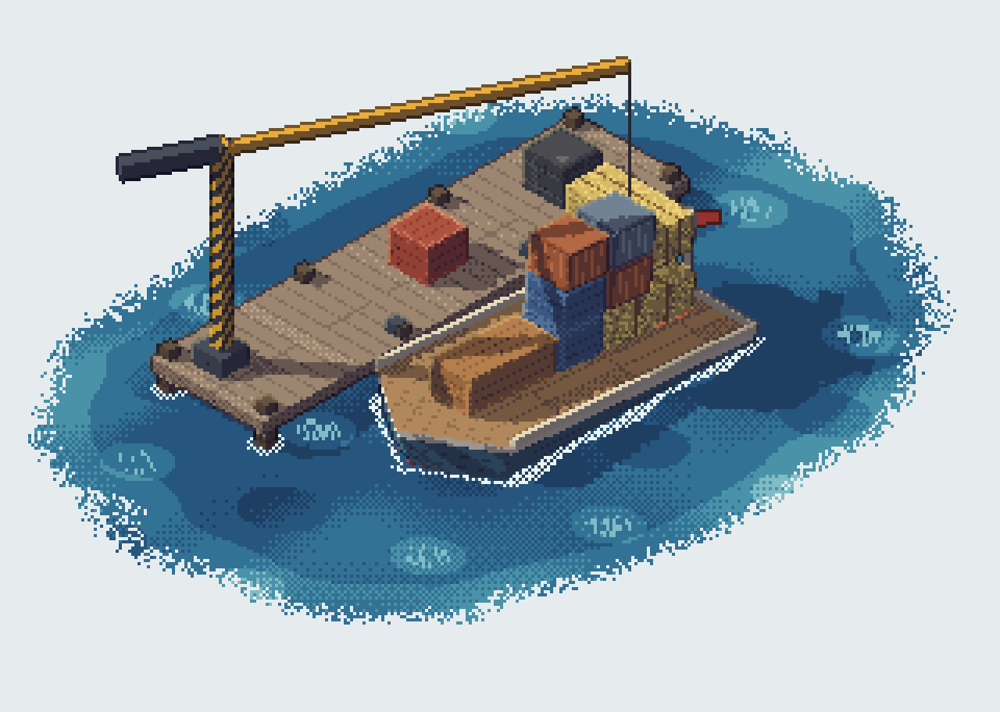

# Dockhand

Load a cargo boat from a tiny floating dock. The crane brings the crates one at a time; you choose where each one lands on the deck. The boat heels and trims with every crate, so a badly placed load slides off or tips the boat over.



**Play:** open [`index.html`](index.html) in a browser. English and Chinese are built in. The page follows the browser language, and the button in the top bar switches it at any time.

## How a day goes

- Three boats a day: a skiff, a narrowboat and a flat barge. Each one arrives with a manifest listing its crates and their weights. You see the manifest once; after that only the next crates waiting on the dock are visible.
- Eleven kinds of cargo, from a one-tonne hay bale to a five-tonne L-shaped machine. Each kind comes in a few random colours.
- Sail whenever you like. The second and third boats sail on their own when the tide runs out.

## Controls

| | Desktop | Phone |
|---|---|---|
| Aim | Move the mouse over the deck, or the arrow keys | Drag anywhere on the page |
| Drop | Click, or Space | Tap |
| Rotate | R, right-click or the mouse wheel | The Rotate button |
| Sail | The Sail button, or Enter | The Sail button |

## Scoring

- A boat that sails away earns the value of its crates. A crate on the second layer counts ×1.5, on the third ×2. A fully covered deck multiplies the boat by ×1.3.
- Tilt into the red and the top crates slide off. A crate that lands in the sea is charged at its value; one that lands on the dock goes back in the queue.
- Capsize or push the rail under water and that boat scores 0.

## How the pictures are drawn

Every frame is rasterised in JavaScript into a 320×228 buffer (sized to the screen on phones) and scaled up by a whole number of device pixels:

- an orthographic camera and a depth buffer, with quads that rotate freely, so crates tilt with the boat;
- a light-space shadow map, so shadows fall across the deck and the cargo, not only the water;
- six-step colour ramps per material that shift toward violet in shadow and warm yellow in light, mixed with a 4×4 Bayer screen;
- outlines from object ids and depth: dark against the water, a warm rim where an object overlaps another;
- water, foam and wake shaded per pixel, stepped at 8 fps.

## Working on it

The sources are in [`src`](src); [`dock/build.py`](build.py) joins them into `dock/index.html` and inlines a font subset.

```bash
pip install fonttools brotli
python3 dock/build.py
python3 dock/build.py --lang zh   # Chinese only, no language switch → dock/dist/zh/index.html
```

| File | What it holds |
|---|---|
| `head.html` | Styles and page markup |
| `engine.js` | Camera, maths, colour ramps |
| `i18n.js` | All player-facing text in English and Chinese |
| `materials.js` | Per-pixel surface patterns for cargo, hull, dock and crane |
| `raster.js` | Frame buffers, water plane, shadow map, triangle rasteriser |
| `game.js` | Cargo and boats, stacking, boat physics, scene building |
| `render.js` | Shading, outlines, rope and particles for one frame |
| `audio.js` | Synthesised sound effects |
| `ui.js` | HUD, manifest, input, game loop |

## Credits

Text uses [Fusion Pixel 12px](https://github.com/TakWolf/fusion-pixel-font) by TakWolf, under the SIL Open Font License 1.1 (see [`dock/FONT-LICENSE.txt`](FONT-LICENSE.txt)). The page embeds a subset of it under the family name `DockPixel`.
